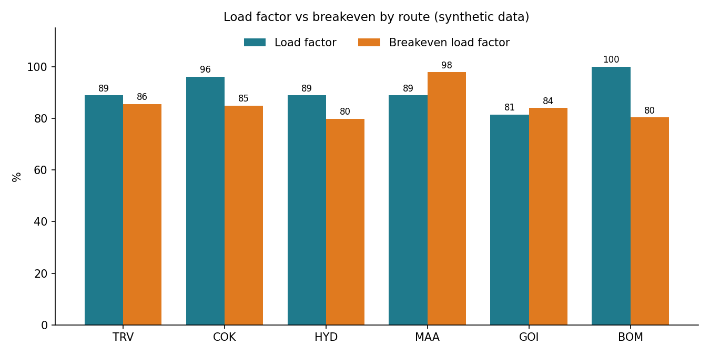

# ✈️ Mini Network Planning Workbench

**A small hub-and-spoke airline you can break, fix and explain.** Built from scratch to learn airline network planning and scheduling by doing it: schedule, demand, fares and costs in, add / hold / cut decisions out.



> **The one idea this project taught me:** a full route is not always a route that needs another flight.

---

## Why this exists

I come from production support, monitoring and incident management in travel technology (Sabre and Amex GBT). I have **not** worked hands-on with airline network planning products. Rather than just say "I learn fast", I spent a focused stretch learning the domain and building something I can show, test and explain.

Everything here uses **synthetic data**. No employer, customer or proprietary information is used.

## The 60-second version

A fictional airline flies from **Bengaluru (BLR)** to six spokes with 23 daily rotations. The workbook turns the schedule into route economics and a recommendation.

| Route | Load factor | Breakeven | Profit (₹ lakh/day) | What the model says |
|---|---|---|---|---|
| BOM | 100% | 80% | 21.9 | Hold: spill is real, but a 6th A320 would **lose ₹8.0 lakh/day** |
| HYD | 89% | 80% | 6.2 | Hold |
| COK | 96% | 85% | 2.2 | Hold |
| TRV | 89% | 86% | 2.2 | Hold, thin cushion |
| GOI | 82% | 84% | -1.3 | Review: cut one rotation (about +₹5.2 lakh/day) |
| MAA | 89% | 98% | -3.1 | Review: swap to ATR72, 6 rotations (about +₹6.3 lakh/day) |

Network: **92.5% load factor, about ₹28.2 lakh/day profit**. With the Goa and Chennai changes, about ₹44 lakh/day before network effects. A schedule retime fixes Mumbai's first arrival, which misses the 10:30 connecting bank by nine minutes.

## What's inside

```
workbook/   Mini_Network_Planning_Workbench.xlsx   the model (346 live formulas, 0 errors)
docs/       concepts.md                            plain-English primer with a worked example
            training-session.md                    15-minute session to teach it
            mock-customer-cases.md                 3 support cases, with how I would handle them
            deck-outline.md                        the 7-slide recommendation, as text
            lessons-learned.md                     what I got wrong and fixed
tools/      build_workbook.py                      script that generates the workbook
assets/     chart used above
```

## Try it in 5 minutes

Open the workbook in Excel or LibreOffice. Yellow cells with blue text are inputs; everything else is a formula.

1. **Chennai:** on `Markets`, set MAA aircraft to `ATR72` and frequency adjustment to `+3`. Watch profit flip from a loss to a gain on `Route_PnL`. Then notice the spill it creates. That is the trade-off.
2. **Cost shock:** on `Inputs`, set cost change to `+10%`. Which routes drop from HOLD to WATCH or REVIEW?
3. **Connections:** on `Schedule`, change rotation R19's BLR departure to `05:30`. The "arrival misses every onward bank" flag clears. Why? (Minimum connect time is 45 minutes.)

## How the model works

```
Inputs + Markets  ->  Schedule  ->  Route_PnL  ->  Recommendation
 (facts, levers)     (rotations,    (capacity, demand, spill,
                      times,         load factor, revenue, cost,
                      connections)   profit, RASK/CASK, breakeven)
```

- **Block time** = distance / cruise speed + taxi/climb allowance
- **Cost per flight** = block hours x cost per block hour + fixed cost per departure
- **Capacity** = daily flights x seats. **Passengers** = MIN(capacity, demand). **Spill** = demand - capacity, if positive
- **Breakeven load factor** = cost / revenue at 100% full
- **Add capacity** only if spill is above a threshold **and** one more flight adds profit

Details and a worked example: [docs/concepts.md](docs/concepts.md).

## Concepts cheat-sheet

| Term | Meaning |
|---|---|
| Leg vs O&D | One flight vs a passenger's whole trip (may use several legs) |
| Block time | Pushback to gate arrival |
| Rotation | One aircraft's chain of flights, here BLR -> spoke -> BLR |
| Bank | A cluster of arrivals then departures so passengers can connect |
| MCT | Minimum connect time: the shortest workable transfer |
| ASK / RPK | Seat-km offered / passenger-km sold |
| Load factor | RPK / ASK |
| RASK / CASK | Revenue / cost per seat-km |
| Yield | Revenue per passenger-km |
| Spill | Demand turned away because the flight is full |
| Breakeven load factor | The load factor where a flight stops losing money |

## What I got wrong, and fixed

My first version recommended **"add capacity"** whenever a route spilled more than 5% of demand. Testing a sixth Mumbai A320 showed profit would **fall by ₹8.0 lakh/day**: 80 spilled passengers cannot fill 180 seats. I added a column that tests the profit from one more flight, and spill alone no longer triggers ADD. Full write-up: [docs/lessons-learned.md](docs/lessons-learned.md).

## Limitations (deliberate)

No spill recapture, no connecting-passenger (O&D) revenue, no fare classes, no slots, no price elasticity, one day only, two aircraft types. Distances are rounded approximate great-circle values, and speeds, costs, fares and demand are my own illustrative assumptions. Real planning tools model all of this; the goal here was to understand the reasoning, not to imitate a product.

## How it was built

I built this with Claude as a tutor and pair-builder, and worked through every formula and concept myself. I can explain any cell. If you open it and ask "why this formula?", I would like to walk through it with you.

## About

Vishnu Chandrakumar | Bengaluru, India | [LinkedIn](https://www.linkedin.com/in/vcsdlinc)

Released under the [MIT License](LICENSE).
